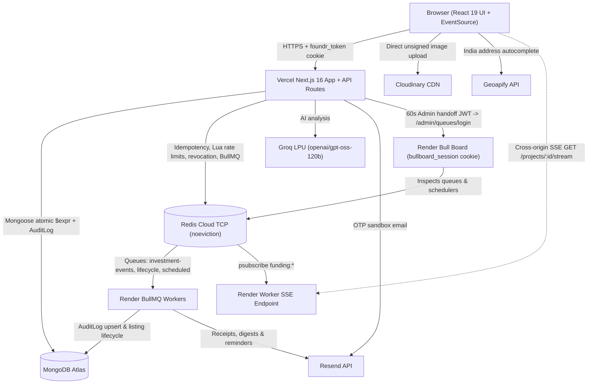
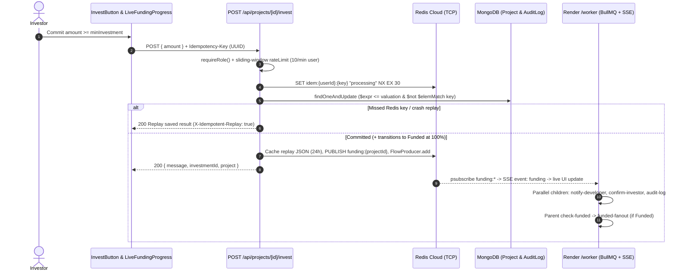

# Foundr — Fractional Real Estate Investment Platform

Fractional commercial & residential real estate marketplace built with Next.js 16, MongoDB Atlas, Redis, BullMQ, and Groq AI risk analysis.

[](https://github.com/ChandanMeher4/Foundr/actions/workflows/ci.yml)
[](https://foundr-gamma.vercel.app/)

> **Disclaimer:** **Demo project: no real money moves and this is not investment advice.** All listings, valuations, and commitments exist strictly for technical demonstration.

---

## Screenshots

<!-- TODO(owner): add screenshots to docs/screenshots/ and link them here -->

Screenshots are being prepared under [docs/screenshots/](docs/screenshots/README.md). *(Add captured UI & Bull Board screenshots there before embedding them in this section.)*

---

## Features by Role

| Role | Capabilities |
| :--- | :--- |
| **Investor** | Browse live & funded properties in List or interactive India Leaflet Map view; search by address/title & filter by category; view real-time SSE funding progress bars; run AI Pros/Risks reports; star/bookmark opportunities; commit fractional INR amounts idempotently |
| **Developer** | Submit new early-stage properties via `/list-project` with Geoapify India address autocomplete and Cloudinary image uploads; monitor portfolio capital raised and investor commitment ledgers on `/developer` |
| **Admin** | Approve/verify (`Live`, sets `approvedAt`) or reject/delete `Pending Review` listings on `/admin`; inspect weekly `PlatformStats` snapshots; revoke all active sessions for a user; access the isolated cross-domain Bull Board queue dashboard |

---

## Architecture

Foundr splits request-driven Next.js serverless routes on **Vercel** from long-running background processing and persistent SSE streams in a standalone Node service (`/worker`) on **Render**, backed by shared **MongoDB Atlas** and **TCP Redis (`noeviction`)**.



### Fractional Investment Sequence



---

## Tech Stack

| Layer | Technology |
| :--- | :--- |
| **Web Framework & UI** | Next.js `16.4.6` (App Router), React `19.2.3`, TypeScript `5`, Tailwind CSS v4 |
| **Database** | MongoDB Atlas via Mongoose (`Project` w/ `2dsphere` index, `User`, `AuditLog`, `PlatformStats`) |
| **Queues & Caching Store** | Hosted TCP Redis (`ioredis` `^6.1.0`, `maxmemory-policy noeviction`), BullMQ `^6.7.10` |
| **Worker Service** | Standalone Node + Express `5` (`tsx` runtime), CORS SSE (`text/event-stream`), `@bull-board/express` |
| **Auth & Security** | Split `jose` HS256 JWT (`src/lib/auth-core.ts` + Redis `jti`/`tokensValidAfter` revocation), `bcryptjs`, Redis Lua rate limiter |
| **External Integrations** | Groq (`openai` SDK -> `openai/gpt-oss-120b`), Resend (`EMAIL_MODE=sandbox\|live`), Cloudinary, Geoapify, Leaflet / CartoDB |
| **Testing & CI** | Vitest `^4.1.12`, ESLint 9 (`eslint-config-next`), GitHub Actions (`mongo:7` + `redis:7` service containers) |

---

## Engineering Highlights (Measured Results)

| Problem Solved | Implementation Pattern | Verified Result (`npm test` / tooling) | Source |
| :--- | :--- | :--- | :--- |
| **Concurrent Overfunding Race** | MongoDB conditional `findOneAndUpdate` (`$expr: currentFunding + amount <= totalValuation` + `$not: { $elemMatch }`) | `20` parallel `₹2,00,000` commitments on a `₹10,00,000` cap yield strictly `5` × `200`, `15` × `400`, final `currentFunding = 1,000,000`, `status = "Funded"` | [tests/concurrency.test.ts](tests/concurrency.test.ts) |
| **Duplicate Clicks & Redis Crash Replay** | Redis `Idempotency-Key` (`NX EX 30` -> `24h` replay cache) + DB `(userId, idempotencyKey)` fallback | `5` duplicate parallel requests create `1` investment; mismatched amount returns `422`; deleting Redis key post-commit replays `200` (`X-Idempotent-Replay: true`) with `1` DB record | [tests/concurrency.test.ts](tests/concurrency.test.ts) |
| **Atomic Sliding-Window Rate Limiting** | Single atomic Redis Lua ZSET script (`rateLimit`) shared across auth, AI & invest routes | `20` parallel burst calls with `limit = 5` allow strictly `5` and block `15` with `retryAfterSeconds >= 1`; resets after window expiry | [tests/phase2.test.ts](tests/phase2.test.ts) |
| **Hardened OTP & Enumeration Defense** | Redis `HMAC-SHA256(SHA-256("otp-v1:" + JWT_SECRET))` (`600s` TTL), `crypto.timingSafeEqual`, 5-attempt delete + lock | `5` wrong codes lock the `6th` valid attempt (`429`); existing and unknown emails return identical `200`; code fails after expiry and single use | [tests/phase2.test.ts](tests/phase2.test.ts) |
| **Token Revocation & Cross-Domain Bull Board** | Mandatory JWT `jti`, `revoked:{jti}` on logout, `tokensValidAfter` on role change/revoke-all, single-use `60s` Bull Board handoff | Legacy no-`jti` JWTs fail verification; logout & `POST /api/admin/users/[id]/revoke-sessions` & role mutation invalidate tokens immediately | [tests/phase2.test.ts](tests/phase2.test.ts) |
| **Delayed Lifecycle & `Asia/Kolkata` Crons** | `lifecycle` (`expire-listing`, `review-reminder`) + `scheduled` (`daily-digest`, `nightly-cleanup`, `weekly-stats`) queues | Stale `approvedAt` / funded deals no-op safely; repeated `registerScheduledJobs` produces `3` deduplicated schedulers; cleanup keeps `AuditLog` intact | [tests/phase2.test.ts](tests/phase2.test.ts) |
| **Bookmark Persistence Across Reloads** | `GET /api/user/star` + server-hydrated `initialStarred` (`React.cache(getSession)`), logged-out redirect to `/login` | Unauthenticated `GET`/`POST` return `401`; toggling persists in MongoDB across reloads; revoked sessions return `401` | [tests/star.test.ts](tests/star.test.ts) |
| **Production Worker Dependency Hygiene** | Runtime `tsx` + static AST import scan before deploy (`npm ci --omit=dev`) | Fails build if `worker/` or transitive `src/` imports depend on any `devDependencies` package | [tools/check-worker-deps.mjs](tools/check-worker-deps.mjs) |

---

## Key Design Decisions

- **Money correctness lives in MongoDB, not Redis:** Atomic conditional updates enforce the `100%` funding ceiling and per-idempotency-key uniqueness in the database ledger; Redis handles locks, rate limits, queues, and Pub/Sub.
- **Separate persistent `/worker` service:** Vercel serverless functions cannot host long-running BullMQ workers or hold long-lived SSE connections, so `/worker` runs independently on Render (without Docker) while sharing MongoDB, Redis, and `src/lib/auth-core.ts`.
- **Signature-only Edge middleware vs. Node revocation:** `src/middleware.ts` avoids `ioredis` so it runs cleanly on Vercel's Edge runtime, enforcing signature, role, and `jti` presence, while `React.cache(getSession)` and `requireRole()` enforce live Redis revocation once per server render/request.
- **Intentional fail-open vs. fail-closed policies:** General sliding-window rate limits and revocation checks fail **open** (with loud logs) so transient Redis blips do not brick site logins, whereas `/api/auth/otp/verify` fails **closed** (`503`/`429`) to prevent brute-forcing 6-digit OTPs.

---

## Run Locally

### Prerequisites
- Node.js `20+` (CI verifies on Node `22`)
- MongoDB instance (local or test URI)
- Redis server (`maxmemory-policy noeviction`)

### Setup & Commands

```bash
git clone https://github.com/ChandanMeher4/Foundr.git
cd Foundr
npm ci
cp .env.example .env.local
# Populate your local values inside .env.local
```

Start Next.js (`http://localhost:3000`) and `/worker` (`http://localhost:4000`) together:

```bash
npm run dev:all
```

Run checks and integration tests (automatically isolated to `*_test` database and `test:` Redis keys via [tests/setup.ts](tests/setup.ts)):

```bash
npm run lint
npm run typecheck
npm run check:worker-deps
npm test
npm run build
```

---

## Deployment Overview

Foundr deploys cleanly without Docker across four managed services (see [.github/workflows/ci.yml](.github/workflows/ci.yml) and [.env.example](.env.example)):

1. **Vercel (Next.js Web App):** Standard Next.js build (`npm run build`).
   - Env vars: `MONGODB_URI`, `REDIS_URL`, `JWT_SECRET`, `GROQ_API_KEY`, `RESEND_API_KEY`, `EMAIL_MODE`, `ADMIN_EMAIL`, `OTP_LOGIN_ENABLED`, `NEXT_PUBLIC_OTP_LOGIN_ENABLED`, `NEXT_PUBLIC_WORKER_URL`, `NEXT_PUBLIC_CLOUDINARY_CLOUD_NAME`, `NEXT_PUBLIC_CLOUDINARY_UPLOAD_PRESET`, `NEXT_PUBLIC_GEOAPIFY_KEY`.
2. **Render (Persistent `/worker` Node Service):**
   - Build command: `npm ci --omit=dev`
   - Start command: `npm run worker`
   - Env vars: `MONGODB_URI`, `REDIS_URL`, `JWT_SECRET` *(identical to Vercel)*, `RESEND_API_KEY`, `EMAIL_MODE`, `ADMIN_EMAIL`, `FRONTEND_ORIGIN` *(e.g., `https://foundr-gamma.vercel.app`)*.
3. **Redis Cloud (Free Tier TCP):** Configured with `maxmemory-policy noeviction`; Next.js uses one shared singleton connection per instance and `/worker` keeps low connection concurrency.
4. **MongoDB Atlas:** Hosts `projects` (`2dsphere` index), `users`, `auditlogs`, and `platform_stats`.

---

## Demo Accounts

Use either dedicated dummy demo account below to evaluate [foundr-gamma.vercel.app](https://foundr-gamma.vercel.app/) without registering:

| Role | Email | Password | Dashboard / Scope |
| :--- | :--- | :--- | :--- |
| **Investor** | `shivamkumar@gmail.com` | `Shivam@1234` | Marketplace, AI Copilot, Starring, Investment Commitments |
| **Developer** | `princediwedi@gmail.com` | `Prince@1234` | `/developer`, `/list-project` |

> **Security Note:** Admin credentials and `/admin` / Bull Board queue dashboards are strictly private and never included in demo documentation.

---

## Honest Operational Notes

- **Worker Cold-Start Wake Delay:** The `/worker` service runs on Render's free tier and can take ~1 minute to wake after idling; UptimeRobot monitors `/health` at 5-minute intervals to keep it warm for live SSE and scheduled crons.
- **Email Sandbox & Live OTP Flag:** Because no custom sending domain is verified on Resend yet, production runs with `EMAIL_MODE=sandbox` and `OTP_LOGIN_ENABLED=false` (OTP UI hidden on the live site).
- **Simulated Commitments:** Payments are not wired yet — clicking commit tests the atomic ledger, idempotency, Redis Pub/Sub SSE, and BullMQ email/audit pipeline without moving money.

---

## Roadmap

- **Razorpay Test-Mode Checkout:** Atomic capacity reservation at checkout with delayed BullMQ expiration release + HMAC-verified webhook queue & dead-letter handling
- **Validation & Contracts:** Request/response Zod schemas and OpenAPI specs (`/api/docs`)
- **Observability:** Structured `pino` logging (`requestId` correlated into BullMQ jobs), Sentry error tracking, `/api/health`, Admin-gated `/api/metrics`, and targeted Playwright E2E coverage
- **Caching & Analytics:** Marketplace read cache (`60s`), `Project`-backed AI response cache (`24h`), and deduplicated 7-day trending rankings (`ZINCRBY` / `ZUNIONSTORE`)

---

## Author

**Chandan Meher (Jeet)** — B.Tech CSE, Dayananda Sagar College of Engineering  
LinkedIn: https://www.linkedin.com/in/chandan-meher-74ab1a2bb/ | Portfolio: https://personal-portfolio-0906.netlify.app/
